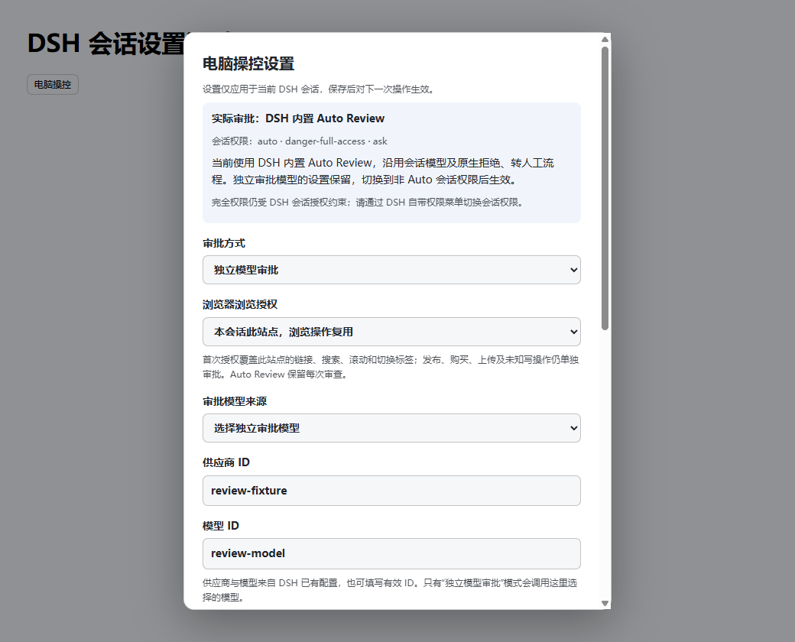
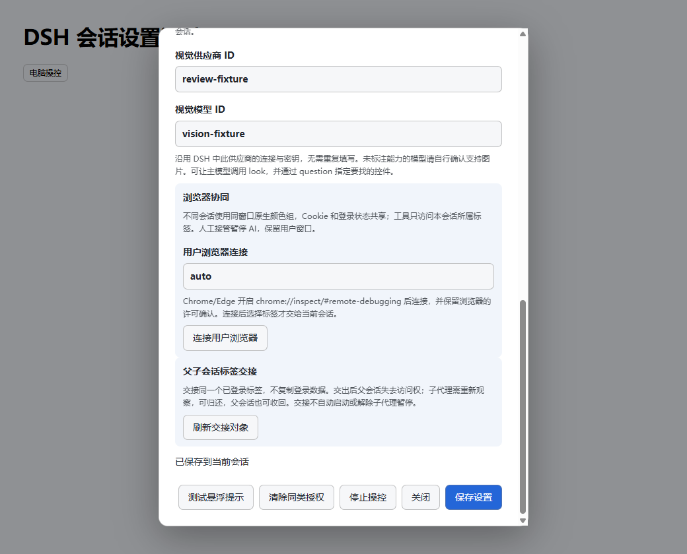
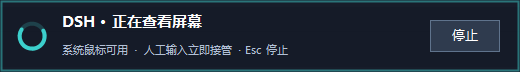
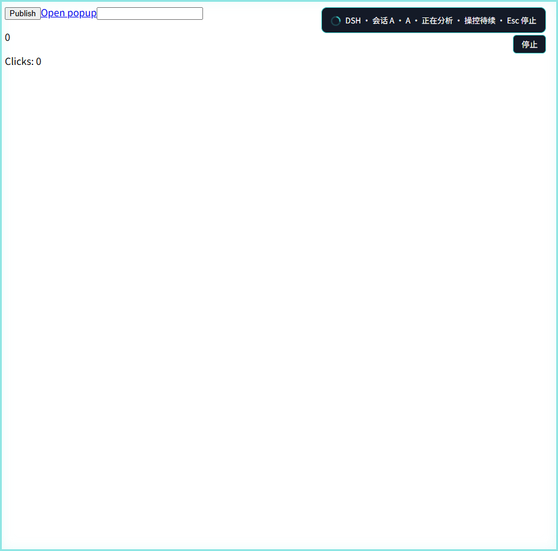
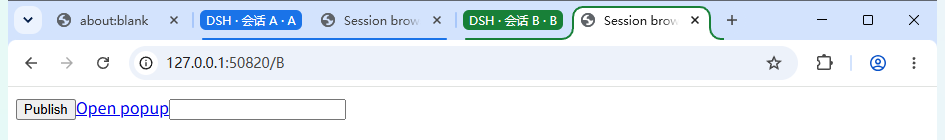
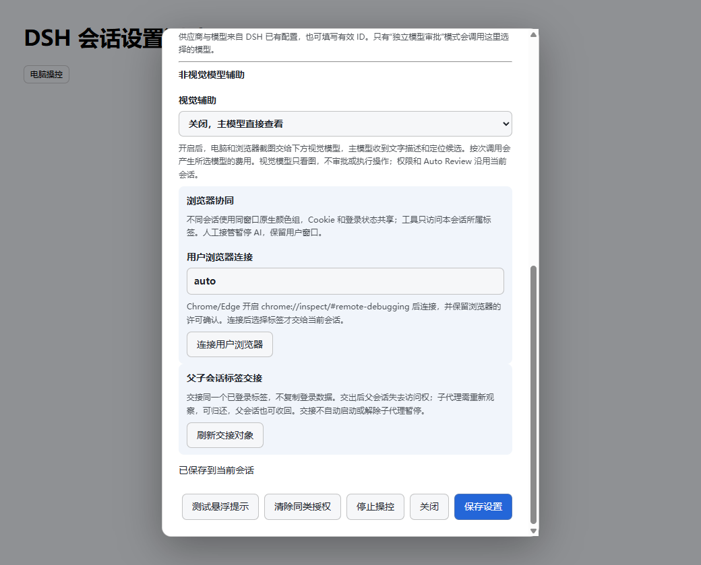

# 图文使用指南

本文图片来自本项目的本地测试页面、GUI 测试夹具和桌面提示实测。它们展示插件真实界面，不是线上业务操作记录；`review-fixture`、`vision-fixture` 等是测试模型 ID，使用时请替换为你在 DSH 中配置的实际 ID。截图没有包含账号凭据。

## 1. 安装并打开设置

在仓库首页选择 Code → Download ZIP，解压后进入项目文件夹。先退出正在运行的 DSH，再执行：

```powershell
powershell -NoProfile -ExecutionPolicy Bypass -File .\Verify.ps1
powershell -NoProfile -ExecutionPolicy Bypass -File .\Install.ps1 -PlanOnly
powershell -NoProfile -ExecutionPolicy Bypass -File .\Install.ps1
```

重新启动 DSH，在会话输入区左侧点击 **电脑操控**。安装需要已有 DSH Desktop 和对应运行时；版本与安装参数见 [首页](../README.md)。

## 2. 设置会话权限与审批模型

先在 DSH 原生权限菜单选择当前会话权限，再打开电脑操控设置。面板顶部的 **实际审批** 说明当前生效流程；插件中的模型选择不会改变 DSH 会话权限。



图中会话处于 Auto，实际使用 **DSH 内置 Auto Review**。即使下方保留独立模型选项，原生 Auto Review 仍优先。非 Auto 会话可选择独立审批模型并填写供应商和模型 ID；如果会话仍为 ask，DSH 的人工审批仍可能先弹出。

浏览授权可选“本会话此站点，浏览操作复用”或“每次操作审批”。复用仅覆盖已批准的浏览范围；发布、购买、上传和性质不明的写操作仍需单独审查。人工模式可记住当前会话的相同目标与参数，不等于授权任意后续请求。

## 3. 非视觉模型连接视觉辅助

主模型不支持图片时，启用视觉辅助，指定支持图片输入的供应商和模型，点击 **保存设置**。沿用 DSH 已有连接和密钥，不需要再填一份密钥。



辅助模型只解释截图，向主模型返回文字和候选位置；它不会审批或执行操作。实际识别准确率取决于所选模型，本项目没有完成远端付费模型的准确率验收。

## 4. 从查看屏幕开始显示提示

首次查看桌面即显示屏幕顶部置顶提示，标明当前查看、审批、操作或等待阶段；切换到其他应用后仍能看到。下图是远程画面提示的实测截图。



人工点击或按键可接管，按 Esc 或点击停止按钮也会停止本轮操控。观察期间普通鼠标移动不会直接抢占；执行路径输入时还会检查人工鼠标移动。停止后需新的人类消息或 GUI 恢复，模型不能自行绕过。

## 5. 浏览器只在页面内提示

浏览器操控使用页面内状态、边框、虚拟鼠标和停止按钮，不显示桌面顶部浮层，也不移动系统鼠标。以下是本地测试页上的持续提示。



多个 DSH 会话使用同一个浏览器窗口的不同颜色原生标签组。工具只能访问当前会话所属或显式交接的标签；共享 Cookie 不代表共享所有页面内存和 sessionStorage。



## 6. 连接已有浏览器并交接原标签

打开 **电脑操控 → 浏览器协同**，填写浏览器连接入口或保留 `auto`，点击 **连接用户浏览器**。浏览器需要按自身版本提供调试许可，并保留浏览器许可确认。不要关闭浏览器安全保护来绕过许可。



让子代理继续已登录页面时：先在 DSH 创建真实直接子代理，再进入 **父子会话标签交接 → 刷新交接对象**，选择当前标签和子代理后交出。子代理必须重新观察同一个 tabId，不能重新 open 来代替交接。交出后父会话失去该标签访问权，子代理完成后归还，父会话也可收回；交接不会自动发送消息、唤醒代理或解除暂停。

## 7. 一次执行输入与点击

先观察同一页面里的输入框和按钮，再提交同一次观察中的真实 elementId：

```json
{"action":"sequence","observationId":"实际观察ID","mode":"mouse","steps":[
  {"action":"type","elementId":"实际输入框ID","text":"已授权的文本"},
  {"action":"click","elementId":"实际按钮ID"}
]}
```

一次支持 1..8 步同页/同窗口动作。审批覆盖明确序列，本地逐步核验；失败会返回已完成步骤，不要重放已经执行的输入或发送。

## 8. 常见问题

| 情况 | 排查方式 |
|---|---|
| 选择模型审批后仍弹 ask | 查看面板顶部“实际审批”和 DSH 会话权限；插件不能提升会话权限。 |
| 控件观察过期或 UI_CHANGED | 重新观察真实目标；语义控件可实时定位，旧截图坐标、节点替换和真正导航仍需严格校验。 |
| DSH 重启后浏览器情况 | 新版专用浏览器独立运行，可连接仍活着的原窗口；旧观察和审批不会恢复，浏览器崩溃或电脑重启不保证保留内存草稿。 |
| 15 分钟无浏览器动作 | 只回收操控提示和授权，不应取消整个模型任务。 |
| 子代理显示“同步中” | 表示运行状态尚未确认；只有明确中止或暂停证据才显示已中止。 |

测试范围及历史限制见 [维护交接](../HANDOFF.md) 与 [验收记录](../reports/)。
